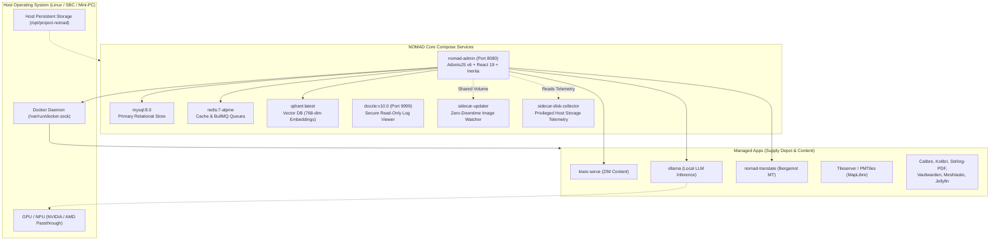
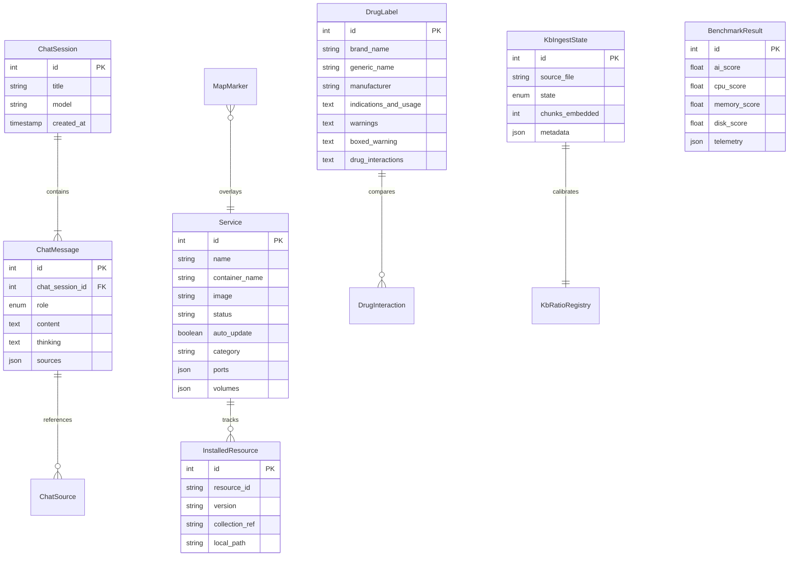

# Project NOMAD — In-Depth Architectural & Technical Analysis

> **Project Name:** Project NOMAD ("Node for Offline Maps, Archives, and Data" / "Knowledge That Never Goes Offline")  
> **Version:** 1.35.1 · **License:** Apache-2.0  
> **Author:** Chris Sherwood / [Crosstalk Solutions, LLC](https://crosstalk.solutions)  
> **Official Site:** [projectnomad.us](https://projectnomad.us)  
> **Core Philosophy:** 100% offline-first, zero telemetry, no authentication by design (shared appliance model), field-deployable for crisis, humanitarian, education, and off-grid scenarios.

---

## 1. System Architecture & Topology

NOMAD employs a **Docker-outside-of-Docker (DooD)** model where the core Command Center container (`admin`) communicates with the host Docker daemon via `/var/run/docker.sock` to orchestrate application containers, manage storage volumes, and pull container images.



---

## 2. Technology Stack Breakdown

### Backend Core

| Layer | Component | Version / Specification | Purpose |
|---|---|---|---|
| **Framework** | [AdonisJS v6](https://adonisjs.com/) | `@adonisjs/core` 6.19.3 | MVC architecture, IoC container, routing, and kernel |
| **Language / Runtime** | Node.js / TypeScript | Node 22 (from `node:22-slim`), TS 5.8.3 | High-performance async runtime with strict types |
| **Primary Database** | MySQL 8.0 | `mysql2` 3.22.5 via `@adonisjs/lucid` 21.8.2 | Persistent state for services, chat sessions, models, and markers |
| **Cache & Queue Store** | Redis 7 Alpine | `ioredis` 5.10.1 + `@rlanz/bull-queue` | Background asynchronous job handling with BullMQ |
| **Vector Database** | Qdrant | `@qdrant/js-client-rest` 1.16.2 | Vector database storing 768-dimensional embeddings for RAG |
| **Embedded DB** | SQLite | `better-sqlite3` 12.6.2 | Dedicated high-throughput store for ~259K FDA drug labels |
| **Real-time Broadcasting**| Adonis Transmit | `@adonisjs/transmit` | Server-Sent Events (SSE) for 1Hz telemetry and progress |
| **Validation Engine** | VineJS | `@vinejs/vine` 3.0.x | Type-safe request payload validation |
| **Container Engine** | Dockerode | `dockerode` 3.3.5 | Direct API communication over `/var/run/docker.sock` |

### Frontend Core

| Layer | Component | Version / Specification | Purpose |
|---|---|---|---|
| **View Layer** | React | 19.2.7 | Client-side rendering driven by Inertia.js page components |
| **Inertia Adapter** | Inertia.js React | `@inertiajs/react` 2.3.13 | Client-side SPA routing without an explicit REST API layer for views |
| **Bundler** | Vite | 6.4.3 | Rapid HMR and optimized production asset compilation |
| **CSS & Design Tokens**| Tailwind CSS | 4.2.2 via `@tailwindcss/vite` | Modern `@theme` tokens; custom "desert" palette and "Night Ops" dark mode |
| **UI Primitives** | Headless UI | `@headlessui/react` 2.2.9 | Accessible dialogs, popovers, dropdowns (`StyledModal`, `StyledButton`) |
| **Icons** | Tabler Icons | `@tabler/icons-react` 3.36.1 | Comprehensive icon set with dynamic icon resolution |
| **Client State** | TanStack Query | `@tanstack/react-query` v5 | Async cache and polling for system, jobs, and services |
| **Map Rendering** | MapLibre GL | `maplibre-gl` 4.7.1 + `react-map-gl` 8.1.0 | GPU-accelerated vector and raster PMTiles rendering |
| **Document Formatting**| Markdoc & React-Markdown| `@markdoc/markdoc` + `react-markdown` | Schema-driven doc pages and markdown chat streaming |
| **File Ingest** | Uppy | `@uppy/react` | Drag-and-drop document upload with chunking for RAG |

---

## 3. Database Models & Schema Relationships



---

## 4. Key Functional Subsystems

### A. Curated Content & Tiered Collections System
The content engine distributes massive archives in a tiered structure configured in [`collections/`](file:///Users/harshchoudhary/project-nomad/collections/):

1. **6 Active Categories** (3 Tiers each: *Essential*, *Standard*, *Comprehensive*):
   - **Medicine (`medicine`)**: NHS Medicines, Military Medicine, CDC Health $\rightarrow$ MedlinePlus, FDA Drug DB $\rightarrow$ Wikipedia Medicine, LibreTexts.
   - **Survival & Preparedness (`survival`)**: Water treatment, Knots, Canadian Prepper $\rightarrow$ Ready.gov, Ham Radio Q&A $\rightarrow$ Post Disaster Library, Military Science.
   - **Education & Reference (`education`)**: Wikibooks $\rightarrow$ TED-Ed, Wikiversity, LibreTexts STEM $\rightarrow$ TED Conference, LibreTexts Humanities.
   - **DIY & Repair (`diy`)**: Woodworking, Vehicle Maintenance $\rightarrow$ Home Improvement $\rightarrow$ iFixit Guides.
   - **Agriculture & Food (`agriculture`)**: FOSS Cooking, Based.Cooking $\rightarrow$ Gardening Q&A, Food for Preppers $\rightarrow$ Homesteading, Project Gutenberg Agriculture.
   - **Computing & Technology (`computing`)**: freeCodeCamp, Language Docs $\rightarrow$ Arduino/Raspberry Pi $\rightarrow$ Electronics, Robotics, Docker.
2. **Cascading Inclusions**: Higher tiers automatically inherit lower tiers through `includesTier: 'essential'`.
3. **Wikipedia Sizing Options**: 6 distinct editions ranging from 331MB ("Quick Reference", 100K articles) to 124GB ("Complete Full").
4. **Creator Packs**: Premium branded video collections (Project NOMAD, Crosstalk Solutions, The Modern Rogue) stored in Cloudflare R2 and entitled via a Cloudflare Worker using the `nomad_app_key` auth protocol with the `nomad-creator-pack-1.0` non-commercial license.

### B. Local AI & Advanced RAG Pipeline
NOMAD delivers fully offline generative intelligence through Ollama and OpenAI-compatible engines:
- **Embedding Engine**: Nomic Embed Text v1.5 (768 dimensions, 2048-token context).
- **Text Chunking**: Powered by `@chonkiejs/core` (1500 target tokens, 150 token overlap).
- **3-Stage Retrieval Pipeline**:
  1. Dense vector similarity search in Qdrant.
  2. Heuristic reranking boosting exact keyword and heading matches.
  3. Source-diversity penalty ensuring varied document citation.
- **Multimodal Ingest**: Handles PDF (with automated Tesseract.js OCR fallback for scanned pages), DOCX (`mammoth`), EPUB, plain text, and ZIM archives (`@openzim/libzim`).
- **Domain Query Expansion**: Prepper and survival acronym dictionary (e.g., SHTF, BOB, EDC, EMP) automatically expands queries prior to vector embedding.
- **Dynamic Sampling Profiles**: 4 distinct sampler presets (*auto*, *focused*, *creative*, *off*) controlling temperature, Top-P, Top-K, and Min-P.

### C. FDA Drug & Medical Condition Engine
A standalone clinical reference designed for emergency scenarios:
- **OpenFDA Ingestion**: Resumable multi-part download of ~1.7GB compressed openFDA archives expanding to an 8–10GB indexed SQLite database holding ~259,000 drug labels.
- **Condition-First Lookup**: 36 primary medical conditions spanning 8 emergency categories mapped directly to OTC drug indications via full-text search.
- **Natural & Home Remedies**: Integrates 18 NCCIH evidence-based herbal remedies and 19 CDC/NIH self-care measures, gated by an independent settings toggle.
- **Interaction Checker**: Multi-drug comparison tool cross-referencing contraindications and boxed warnings.

### D. Offline Mapping (PMTiles & MapLibre)
- **Topographic Storage**: Uses PMTiles single-file archive format.
- **Regional Coverage**: 9 US regional collections hosted on GitHub (`Crosstalk-Solutions/project-nomad-maps`) covering all 50 states.
- **Extraction & Slicing**: Bundles the pinned `go-pmtiles` CLI (v1.30.2 with SHA256 verification) for localized map slicing.
- **Interactive UI**: MapLibre GL canvas with pin drop, coordinate search, custom marker creation, and offline vector tile rendering.

### E. Offline Machine Translation (`nomad-translate`)
- Reverse proxy deployed directly in front of Kiwix.
- Uses **Mozilla Bergamot** offline machine translation models (from Firefox Remote Settings).
- Supports 50 languages with zero external network connectivity.
- Executes ~1600x faster than local LLM translation without requiring GPU acceleration.

### F. Supply Depot & Container Management
- App store interface for Docker-managed field utilities (Calibre-Web, Kolibri, Stirling-PDF, IT-Tools, Vaultwarden, Homebox, Jellyfin, Meshtastic).
- Live container inspection: logs viewer, memory/CPU statistics, and configuration editing.
- Sidecar updater architecture allowing the `admin` container to self-update safely via shared Docker volume communication (`nomad-update-shared`).

---

## 5. Background Processing & Queue Jobs (BullMQ)

The Redis queue (`@rlanz/bull-queue`) orchestrates 12 specialized background job workers:

| Job Name | Queue | Operational Responsibilities |
|---|---|---|
| `RunDownloadJob` | `downloads` | Resumable chunked file downloads with retry & backoff |
| `DownloadModelJob` | `model-downloads` | Streaming Ollama LLM weight pulls |
| `EmbedFileJob` | default | Document extraction, chunking, and Qdrant vector indexing |
| `RunBenchmarkJob` | `benchmarks` | Full system stress testing with 1Hz live telemetry output |
| `AutoUpdateJob` | default | Core NOMAD system update checks |
| `AppAutoUpdateJob` | default | Managed Supply Depot container version synchronization |
| `ContentAutoUpdateJob`| default | ZIM, Map, and Dataset catalog update verification |
| `CheckServiceUpdatesJob`| default | Remote registry tag inspection |
| `DownloadDrugDataJob` | default | Multi-part openFDA database downloading |
| `IngestDrugDataJob` | default | Streaming openFDA JSON parsing into SQLite tables |
| `RunExtractPmtilesJob`| default | Background execution of `go-pmtiles extract` |

---

## 6. Testing, Evaluation & Quality Assurance

Project NOMAD features an enterprise-grade testing and evaluation infrastructure:
- **Test Runners**: Native AdonisJS runner (`@japa/runner` 4.5.0) paired with Node's native test runner (`node --test`).
- **Unit & Functional Tests**: Over 60 unit test suites validating streaming tokens, RAG chunking accuracy, drug search ranking, and update safety.
- **RAG Evaluation Harness**:
  ```bash
  node ace eval:corpus --ingest                 # Ingest standardized test corpus
  node ace eval:retrieval --ablate              # Evaluate retrieval accuracy & ablation
  node ace eval:generation --model=<m> --all-modes # Measure RAG answer generation quality
  node ace eval:matrix                          # Cross-model evaluation matrix
  ```
- **Update Simulation**: `node ace auto-update:dry-run --scenarios` for deterministic validation of upgrade paths without touching live containers.

---

## 7. Strategic Recommendations & Roadmap

1. **Finish the Collections Roadmap**: Accelerate completion of the categories outlined in [CATEGORIES-TODO.md](file:///Users/harshchoudhary/project-nomad/collections/CATEGORIES-TODO.md) (Trades & Vocational, Agriculture, Languages, Regional bundles).
2. **Global Maps Coverage**: Expand PMTiles bundles beyond US state bounds to support global crisis zones and humanitarian corridors.
3. **PWA Offline Client**: Introduce Service Worker caching for the administrative frontend so client tablets can retain the dashboard interface when disconnected from the NOMAD Wi-Fi AP.
4. **Mesh Networking Integration**: Deepen integration with Meshtastic/MeshCore to allow low-bandwidth text transmission of medical and map alerts across long-range off-grid radio links.
