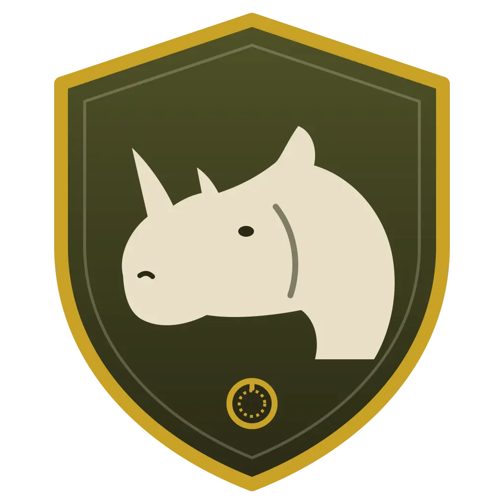

<div align="center">


# RhinoVault
### Your Offline Digital Survival Computer

**Knowledge, tools and private AI that keep working when the internet doesn't.**

[](https://github.com/rhinopctec/project-RhinoVault)
[](https://github.com/Crosstalk-Solutions/project-nomad)

</div>

---

RhinoVault is a self-contained, offline digital survival computer that combines essential tools, a trusted knowledge base, emergency resources and private AI in one platform, keeping you informed, prepared and empowered anytime, anywhere, even without an internet connection.

RhinoVault is built and supported by **RhinoPCTec**. It is based on [Project N.O.M.A.D.](https://github.com/Crosstalk-Solutions/project-nomad) by Crosstalk Solutions, LLC, used under the Apache License 2.0. See [NOTICE](NOTICE) for attribution details.

## Installation & Quickstart
RhinoVault can be installed on any Debian-based operating system (we recommend Ubuntu). Installation is completely terminal-based, and all tools and resources are designed to be accessed through the browser, so there's no need for a desktop environment if you'd rather setup RhinoVault as a "server" and access it through other clients.

*Note: sudo/root privileges are required to run the install script*

### Quick Install (Debian-based OS Only)
```bash
sudo apt-get update && \
sudo apt-get install -y curl && \
curl -fsSL https://raw.githubusercontent.com/rhinopctec/project-RhinoVault/refs/heads/main/install/install_nomad.sh \
  -o install_nomad.sh && \
sudo bash install_nomad.sh
```

RhinoVault is now installed on your device! Open a browser and navigate to `http://localhost:8080` (or `http://DEVICE_IP:8080`) to start exploring!

For a step-by-step walkthrough (including Ubuntu installation and WSL2 on Windows), the upstream [Project N.O.M.A.D. Installation Guide](https://www.projectnomad.us/install) applies to RhinoVault too. Use the RhinoVault install command above in place of theirs.

### Advanced Installation
For more control over the installation process, copy and paste the [Docker Compose template](https://raw.githubusercontent.com/rhinopctec/project-RhinoVault/refs/heads/main/install/management_compose.yaml) into a `docker-compose.yml` file and customize it to your liking (be sure to replace any placeholders with your actual values). Then, run `docker compose up -d` to start the Command Center and its dependencies. Note: this method is recommended for advanced users only, as it requires familiarity with Docker and manual configuration before starting.

## How It Works
RhinoVault is a management UI ("Command Center") and API that orchestrates a collection of containerized tools and resources via [Docker](https://www.docker.com/). It handles installation, configuration, and updates for everything — so you don't have to.

**Built-in capabilities include:**
- **AI Chat with Knowledge Base** — local AI chat powered by [Ollama](https://ollama.com/) or you can use OpenAI API compatible software such as LM Studio or llama.cpp, with document upload and semantic search (RAG via [Qdrant](https://qdrant.tech/))
- **Information Library** — offline Wikipedia, medical references, ebooks, and more via [Kiwix](https://kiwix.org/)
- **Education Platform** — Khan Academy courses with progress tracking via [Kolibri](https://learningequality.org/kolibri/)
- **Offline Maps** — downloadable regional maps via [ProtoMaps](https://protomaps.com)
- **Data Tools** — encryption, encoding, and analysis via [CyberChef](https://gchq.github.io/CyberChef/)
- **Notes** — local note-taking via [FlatNotes](https://github.com/dullage/flatnotes)
- **System Benchmark** — hardware scoring with a [community leaderboard](https://benchmark.projectnomad.us)
- **Supply Depot** — a one-click app catalog (PDF tools, file browser, e-book library, password manager, and more) plus the ability to run your own custom Docker containers
- **Automatic Updates** — opt-in, hands-off updates for the core software, installed apps, and offline content, on a schedule you control
- **Easy Setup Wizard** — guided first-time configuration with curated content collections

RhinoVault also includes built-in tools like a Wikipedia content selector, ZIM library manager, and content explorer.

## What's Included

| Capability | Powered By | What You Get |
|-----------|-----------|-------------|
| Information Library | Kiwix | Offline Wikipedia, medical references, survival guides, ebooks |
| AI Assistant | Ollama + Qdrant | Built-in chat with document upload and semantic search |
| Education Platform | Kolibri | Khan Academy courses, progress tracking, multi-user support |
| Offline Maps | ProtoMaps | Downloadable regional maps for offline viewing and search |
| Data Tools | CyberChef | Encryption, encoding, hashing, and data analysis |
| Notes | FlatNotes | Local note-taking with markdown support |
| System Benchmark | Built-in | Hardware scoring, Builder Tags, and community leaderboard |
| Supply Depot | Built-in | One-click app catalog + bring-your-own custom Docker containers |

## Device Requirements
While many similar offline survival computers are designed to be run on bare-minimum, lightweight hardware, RhinoVault is quite the opposite. To install and run the
available AI tools, we highly encourage the use of a beefy, GPU-backed device to make the most of your install.

At its core, however, RhinoVault is still very lightweight. For a barebones installation of the management application itself, the following minimal specs are required:

*Note: RhinoVault is not sponsored by any hardware manufacturer and is designed to be as hardware-agnostic as possible. The hardware listed below is for example/comparison use only*

#### Minimum Specs
- Processor: 2 GHz dual-core processor or better
- RAM: 4GB system memory
- Storage: At least 5 GB free disk space
- OS: Debian-based (Ubuntu recommended)
- Stable internet connection (required during install only)

To run LLMs and other included AI tools:

#### Optimal Specs
- Processor: AMD Ryzen 7 or Intel Core i7 or better
- RAM: 32 GB system memory
- Graphics: NVIDIA RTX 3060 or AMD equivalent or better (more VRAM = run larger models)
- Storage: At least 250 GB free disk space (preferably on SSD)
- OS: Debian-based (Ubuntu recommended)
- Stable internet connection (required during install only)

**For build recommendations at several price points, the upstream [Hardware Guide](https://www.projectnomad.us/hardware) applies to RhinoVault too.**

Again, RhinoVault itself is quite lightweight — it's the tools and resources you choose to install with RhinoVault that will determine the specs required for your unique deployment

#### Running AI models on a different host
By default, RhinoVault's installer will attempt to setup Ollama on the host when the AI Assistant is installed. However, if you would like to run the AI model on a different host, you can go to the settings of the AI assistant and input a URL for either an ollama or OpenAI-compatible API server (such as LM Studio).  
Note that if you use Ollama on a different host, you must start the server with this option: `OLLAMA_HOST=0.0.0.0`.  
Ollama is the preferred way to use the AI assistant, as it has features such as model download that OpenAI API does not support. So when using LM Studio, for example, you will have to use LM Studio to download models.
You are responsible for the setup of Ollama/OpenAI server on the other host.

## Frequently Asked Questions (FAQ)
For answers to common questions about RhinoVault, please see our [FAQ](FAQ.md) page.

## About Internet Usage & Privacy
RhinoVault is designed for offline usage. An internet connection is only required during the initial installation (to download dependencies) and if you (the user) decide to download additional tools and resources at a later time. Otherwise, RhinoVault does not require an internet connection and has ZERO built-in telemetry.

To test internet connectivity, RhinoVault first attempts to make a request to Cloudflare's utility endpoint, `https://1.1.1.1/cdn-cgi/trace`. If that endpoint is unreachable (for example, because your network blocks `1.1.1.1`), it falls back to other endpoints the application already contacts (the GitHub API and the upstream Project N.O.M.A.D. API, which supplies the recommended AI model list) and considers the connection online if any of them respond.

You can override the endpoint used for this check in two ways. The connectivity test URL can be configured from the UI under **Settings → Advanced** (stored locally on your instance), or you can set the `INTERNET_STATUS_TEST_URL` environment variable. When set, the environment variable always takes precedence over the UI-configured value. If neither is set, the built-in defaults above are used.

## About Security
By design, RhinoVault is intended to be open and available without hurdles — it includes no authentication. If you decide to connect your device to a local network after install (e.g. for allowing other devices to access its resources), you can block/open ports to control which services are exposed.

**Will authentication be added in the future?** Maybe. It's not currently a priority, but if there's enough demand for it, we may consider building in an optional authentication layer in a future release to support use cases where multiple users need access to the same instance but with different permission levels (e.g. family use with parental controls, classroom use with teacher/admin accounts, etc.). For remote access, put RhinoVault behind an authenticating proxy such as Cloudflare Zero Trust Access rather than exposing it directly.

For now, we recommend using network-level controls to manage access if you're planning to expose your RhinoVault instance to other devices on a local network. RhinoVault is not designed to be exposed directly to the internet, and we strongly advise against doing so unless you really know what you're doing, have taken appropriate security measures, and understand the risks involved.

## Contributing
Contributions are welcome and appreciated! Please see [CONTRIBUTING.md](CONTRIBUTING.md) for guidelines on how to contribute to the project.

### Testing Auto-Updates (Dry Run)

The Command Center can automatically install **minor/patch** updates of itself during a configurable window, after a cool-off period, and only when pre-flight checks pass (sufficient disk for the new image, no downloads or app installs in progress). Major versions always require a manual update.

Because exercising this logic with real version bumps is impractical, an Ace command runs the **entire decision pipeline without ever triggering an update**. Run it from the `admin/` directory:

```bash
# 1) Deterministic scenario suite — no network, DB, or Docker required.
#    Proves every branch (major-only, cool-off, prerelease/draft, window wrap, …)
#    and exits non-zero on failure, so it's safe to wire into CI.
node ace auto-update:dry-run --scenarios

# 2) Simulate "what would happen if I were running 1.32.0 right now?"
#    against the LIVE GitHub releases feed and real pre-flight checks:
node ace auto-update:dry-run --current=1.32.0 --force-enabled

# 3) Fully offline simulation with a canned release list and a fixed clock:
node ace auto-update:dry-run --current=1.32.0 --force-enabled \
  --releases-file=./fixtures/releases.json --now=2026-06-04T21:00:00Z \
  --window-start=20:00 --window-end=23:00 --cooloff=72 --skip-preflight
```

It prints the resolved decision — current version, whether the clock is inside the window, the eligible target (if any), and pre-flight blockers — ending in a clear verdict such as `WOULD UPDATE → v1.33.2` or `WOULD NOT UPDATE (outside-window): …`. **No real update is ever requested.**

| Flag | Description |
|------|-------------|
| `--scenarios` | Run the built-in deterministic scenario suite and exit |
| `--current=<version>` | Simulate this currently-running version (e.g. `1.32.0`) |
| `--force-enabled` | Treat auto-update as enabled, ignoring the saved setting |
| `--cooloff=<hours>` | Override the cool-off period |
| `--window-start=<HH:MM>` / `--window-end=<HH:MM>` | Override the update window |
| `--now=<ISO timestamp>` | Simulate the clock at a specific time |
| `--releases-file=<path>` | Use a local JSON releases array instead of fetching GitHub (offline) |
| `--skip-preflight` | Bypass the Docker/disk/queue pre-flight checks |

## Community & Resources

- **Support & Discussions:** [GitHub Discussions](https://github.com/rhinopctec/project-RhinoVault/discussions)
- **Report a bug:** [GitHub Issues](https://github.com/rhinopctec/project-RhinoVault/issues)
- **FAQ:** [FAQ.md](FAQ.md)
- **Community Add-Ons:** [admin/docs/community-add-ons.md](admin/docs/community-add-ons.md). Most Project N.O.M.A.D. add-ons work with RhinoVault.
- **Upstream project:** [Project N.O.M.A.D.](https://github.com/Crosstalk-Solutions/project-nomad) by Crosstalk Solutions

## Maintainer Notes: Publishing RhinoVault

The installer pulls the Command Center images from `ghcr.io/rhinopctec/rhinovault*`, and the update checker reads this repository's GitHub Releases. Before the installer works, publish them once:

1. **Enable Actions** on the fork (Actions tab → "I understand my workflows, go ahead and enable them").
2. **Authorize yourself to publish:** Settings → Secrets and variables → Actions → New repository secret named `DEPLOYMENT_AUTHORIZED_USERS` containing your GitHub username (`rhinopctec`).
3. **Build the images:** run the *Build Primary Docker Image*, *Build Sidecar Updater* and *Build Disk Collector* workflows with the current version (e.g. `1.33.0`) and `tag_latest` checked.
4. **Make the packages public:** on your GitHub profile → Packages, set each `rhinovault*` package's visibility to Public, so installs don't need a registry login.
5. **Create a release** tagged `v1.33.0` so the update checker has something to compare against.

Internal names such as the `nomad_*` container names, the `/opt/project-nomad` install directory and the `NOMAD_*` environment variables are intentionally unchanged, so upstream updates can be merged with minimal conflicts:

```bash
git remote add upstream https://github.com/Crosstalk-Solutions/project-nomad.git
git fetch upstream && git merge upstream/main
```

## License

RhinoVault is licensed under the [Apache License 2.0](LICENSE). It is based on Project N.O.M.A.D., copyright Crosstalk Solutions, LLC. Project N.O.M.A.D. is a trademark of Crosstalk Solutions, LLC; RhinoVault is an independent project and is not affiliated with or endorsed by Crosstalk Solutions.

## Helper Scripts
Once installed, RhinoVault has a few helper scripts should you ever need to troubleshoot issues or perform maintenance that can't be done through the Command Center. All of these scripts are found in RhinoVault's install directory, `/opt/project-nomad`

###

###### Start Script - Starts all installed project containers
```bash
sudo bash /opt/project-nomad/start_nomad.sh
```
###

###### Stop Script - Stops all installed project containers
```bash
sudo bash /opt/project-nomad/stop_nomad.sh
```
###

###### Update Script - Attempts to pull the latest images for the Command Center and its dependencies (i.e. mysql) and recreate the containers. Note: this *only* updates the Command Center containers. It does not update the installable application containers - that should be done through the Command Center UI
```bash
sudo bash /opt/project-nomad/update_nomad.sh
```

###### Uninstall Script - Need to start fresh? Use the uninstall script to make your life easy. Note: this cannot be undone!
```bash
curl -fsSL https://raw.githubusercontent.com/rhinopctec/project-RhinoVault/refs/heads/main/install/uninstall_nomad.sh -o uninstall_nomad.sh && sudo bash uninstall_nomad.sh
```
