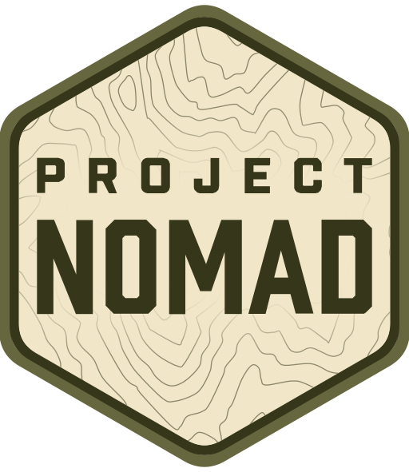

<div align="center">


# Project NOMAD
### Conhecimento que nunca fica offline

[](https://www.projectnomad.us)
[](https://discord.com/invite/crosstalksolutions)
[](https://benchmark.projectnomad.us)

</div>

**Idiomas:** [English](README.md) · [Português (Brasil)](README.pt-BR.md)

---

O Project NOMAD é um servidor autossuficiente de conhecimento e educação, focado em funcionar offline, repleto de ferramentas essenciais, conhecimento e IA para manter você informado e capacitado — a qualquer hora e em qualquer lugar.

## Instalação e Início Rápido
O Project NOMAD pode ser instalado em qualquer sistema operacional baseado em Debian (recomendamos o Ubuntu 26.04 LTS; 24.04 LTS e Debian 12 também são suportados). A instalação é feita inteiramente pelo terminal, e todas as ferramentas e recursos foram criados para serem acessados pelo navegador. Portanto, você não precisa de um ambiente de desktop se preferir configurar o NOMAD como "servidor" e acessá-lo por outros clientes.

**Antes de começar:** o NOMAD em si precisa de cerca de **5 GB de disco e menos de 1 GB de RAM**. O conteúdo offline que você adicionar depois é o que realmente ocupa o espaço em disco, e o Assistente de IA é o que eleva o consumo de memória. Consulte [Requisitos do Dispositivo](#requisitos-do-dispositivo) para ambos, e a [FAQ](https://www.projectnomad.us/docs/faq) para os tamanhos individuais de cada conteúdo.

*Nota: são necessários privilégios sudo/root para executar o script de instalação*

### Instalação Rápida (somente em sistemas baseados em Debian)
```bash
sudo apt-get update && \
sudo apt-get install -y curl && \
curl -fsSL https://raw.githubusercontent.com/Crosstalk-Solutions/project-nomad/refs/heads/main/install/install_nomad.sh \
  -o install_nomad.sh && \
sudo bash install_nomad.sh
```

O Project NOMAD já está instalado no seu dispositivo! Abra um navegador e acesse `http://localhost:8080` (ou `http://DEVICE_IP:8080`) para começar a explorar!

Para um guia completo passo a passo (incluindo a instalação no Ubuntu), consulte o [Guia de Instalação](https://www.projectnomad.us/install). Para usuários de Windows, consulte o [guia de instalação com WSL2](https://www.projectnomad.us/install/wsl2) — uma opção mantida pela comunidade que cobre as rotas de instalação via Docker nativo e Docker Desktop.

### Instalação Avançada
Para ter mais controle sobre o processo de instalação, copie e cole o [modelo do Docker Compose](https://raw.githubusercontent.com/Crosstalk-Solutions/project-nomad/refs/heads/main/install/management_compose.yaml) em um arquivo `docker-compose.yml` e personalize-o como desejar (lembre-se de substituir todos os marcadores pelos seus valores reais). Em seguida, execute `docker compose up -d` para iniciar a Central de Comando e suas dependências. Observação: este método é recomendado apenas para usuários avançados, pois exige familiaridade com o Docker e configuração manual antes da inicialização.

## Como Funciona
O NOMAD é uma interface de gerenciamento — a "Central de Comando" (Command Center) — e uma API que orquestra uma coleção de ferramentas e recursos em contêineres por meio do [Docker](https://www.docker.com/). Ele cuida da instalação, configuração e atualizações de tudo — para que você não precise fazer isso.

**Os recursos integrados incluem:**
- **Chat com IA e Base de Conhecimento** — chat de IA local com [Ollama](https://ollama.com/), ou você pode usar software compatível com a API da OpenAI, como LM Studio ou llama.cpp, com envio de documentos e busca semântica (RAG via [Qdrant](https://qdrant.tech/))
- **Biblioteca de Informações** — Wikipédia offline, referências médicas, e-books e mais, via [Kiwix](https://kiwix.org/)
- **Plataforma de Educação** — cursos da Khan Academy com acompanhamento de progresso via [Kolibri](https://learningequality.org/kolibri/)
- **Mapas Offline** — mapas regionais para download via [ProtoMaps](https://protomaps.com)
- **Ferramentas de Dados** — criptografia, codificação e análise via [CyberChef](https://gchq.github.io/CyberChef/)
- **Notas** — anotações locais via [FlatNotes](https://github.com/dullage/flatnotes)
- **Benchmark do Sistema** — pontuação de hardware com um [ranking da comunidade](https://benchmark.projectnomad.us)
- **Depósito de Suprimentos (Supply Depot)** — um catálogo de aplicativos com instalação em um clique (ferramentas para PDF, navegador de arquivos, biblioteca de e-books, gerenciador de senhas e muito mais), além da possibilidade de executar seus próprios contêineres Docker personalizados
- **Atualizações Automáticas** — atualizações opcionais e sem intervenção para o software principal, os aplicativos instalados e o conteúdo offline, em um agendamento que você controla
- **Assistente de Configuração** — configuração inicial guiada com coleções de conteúdo selecionadas

O NOMAD também inclui ferramentas integradas como um seletor de conteúdo da Wikipédia, um gerenciador de bibliotecas ZIM e um explorador de conteúdo.

## O que está incluído

| Recurso | Tecnologia | O que você obtém |
|-----------|-----------|-------------|
| Biblioteca de Informações | Kiwix | Wikipédia offline, referências médicas, guias de sobrevivência, e-books |
| Assistente de IA | Ollama + Qdrant | Chat integrado com envio de documentos e busca semântica |
| Plataforma de Educação | Kolibri | Cursos da Khan Academy, acompanhamento de progresso, suporte a múltiplos usuários |
| Mapas Offline | ProtoMaps | Mapas regionais para download, com visualização e busca offline |
| Ferramentas de Dados | CyberChef | Criptografia, codificação, hashing e análise de dados |
| Notas | FlatNotes | Anotações locais com suporte a markdown |
| Benchmark do Sistema | Integrado | Pontuação de hardware, Etiquetas de Construtor (Builder Tags) e ranking da comunidade |
| Depósito de Suprimentos | Integrado | Catálogo de aplicativos com um clique + traga seus próprios contêineres Docker |

## Requisitos do Dispositivo
Embora muitos computadores de sobrevivência offline semelhantes sejam projetados para funcionar com hardware mínimo e leve, o Project NOMAD é bem o oposto. Para instalar e executar as
ferramentas de IA disponíveis, recomendamos fortemente o uso de um dispositivo potente com GPU, para aproveitar ao máximo a sua instalação.

No entanto, em sua essência, o NOMAD ainda é muito leve. Para uma instalação mínima do próprio aplicativo de gerenciamento, os seguintes requisitos mínimos são necessários:

*Nota: o Project NOMAD não é patrocinado por nenhum fabricante de hardware e foi projetado para ser o mais independente de hardware possível. O hardware listado abaixo serve apenas como exemplo/comparação*

#### Especificações mínimas
- Processador: processador dual-core de 2 GHz ou superior
- RAM: 4 GB de memória do sistema (toda a pilha sem IA roda em menos de 1 GB)
- Armazenamento: pelo menos 5 GB de espaço livre em disco (planeje 10 GB para instalar com folga)
- Sistema operacional: baseado em Debian (Ubuntu 26.04 LTS recomendado)
- Conexão de internet estável (necessária apenas durante a instalação)

Adicionar o Assistente de IA eleva a instalação para cerca de **25 GB**, pois o Ollama e um modelo de uso geral são ambos grandes, e um modelo precisa de aproximadamente o tamanho de seu download em memória enquanto responde. Essa memória vem da VRAM, caso você tenha uma GPU dedicada, ou da RAM do sistema, caso não tenha — esse é o principal motivo pelo qual os números abaixo são tão maiores.

Para executar LLMs e outras ferramentas de IA incluídas:

#### Especificações ideais
- Processador: AMD Ryzen 7 ou Intel Core i7 ou superior
- RAM: 32 GB de memória do sistema
- Placa de vídeo: NVIDIA RTX 3060 ou equivalente da AMD ou superior (mais VRAM = modelos maiores)
- Armazenamento: pelo menos 250 GB de espaço livre em disco (de preferência em SSD)
- Sistema operacional: baseado em Debian (Ubuntu 26.04 LTS recomendado)
- Conexão de internet estável (necessária apenas durante a instalação)

**Para recomendações detalhadas de montagem em três faixas de preço (US$ 150 a US$ 1.000+), consulte o [Guia de Hardware](https://www.projectnomad.us/hardware).**

Mais uma vez, o Project NOMAD em si é bastante leve — são as ferramentas e os recursos que você escolhe instalar com o NOMAD que determinarão os requisitos da sua implantação específica

#### Executando modelos de IA em outro host
Por padrão, o instalador do NOMAD tentará configurar o Ollama no host quando o Assistente de IA for instalado. No entanto, se você quiser executar o modelo de IA em outro host, acesse as configurações do assistente de IA e informe uma URL de um servidor Ollama ou compatível com a API da OpenAI (como o LM Studio).  
Observe que, se usar o Ollama em outro host, você deve iniciar o servidor com esta opção: `OLLAMA_HOST=0.0.0.0`.  
O Ollama é a forma preferencial de usar o assistente de IA, pois oferece recursos como download de modelos, que a API da OpenAI não suporta. Portanto, ao usar o LM Studio, por exemplo, você terá que usar o próprio LM Studio para baixar os modelos.
Você é responsável pela configuração do servidor Ollama/OpenAI no outro host.

## Perguntas Frequentes (FAQ)
Para obter respostas às perguntas comuns sobre o Project NOMAD, consulte a nossa página de [FAQ](FAQ.md).

## Sobre o uso da internet e a privacidade
O Project NOMAD foi projetado para uso offline. Uma conexão com a internet só é necessária durante a instalação inicial (para baixar dependências) e se você (o usuário) decidir baixar ferramentas e recursos adicionais posteriormente. Fora isso, o NOMAD não requer conexão com a internet e não possui NENHUMA telemetria integrada.

Para testar a conectividade com a internet, o NOMAD primeiro tenta fazer uma requisição ao endpoint utilitário da Cloudflare, `https://1.1.1.1/cdn-cgi/trace`. Se esse endpoint estiver inacessível (por exemplo, porque sua rede bloqueia `1.1.1.1`), ele recorre a outros endpoints que a aplicação já contata (a API do GitHub e a API do Project NOMAD) e considera a conexão online se qualquer um deles responder.

Você pode substituir o endpoint usado nessa verificação de duas maneiras. A URL do teste de conectividade pode ser configurada pela interface, em **Configurações → Avançado** (armazenada localmente na sua instância), ou você pode definir a variável de ambiente `INTERNET_STATUS_TEST_URL`. Quando definida, a variável de ambiente sempre tem precedência sobre o valor configurado na interface. Se nenhuma das duas estiver definida, os padrões integrados acima são usados.

## Sobre a segurança
Por design, o Project NOMAD tem como objetivo ser aberto e acessível sem obstáculos — ele não inclui autenticação. Se você decidir conectar seu dispositivo a uma rede local após a instalação (por exemplo, para permitir que outros dispositivos acessem seus recursos), você pode bloquear/liberar portas para controlar quais serviços são expostos.

**A autenticação será adicionada no futuro?** Talvez. Não é uma prioridade no momento, mas, se houver demanda suficiente, podemos considerar a criação de uma camada de autenticação opcional em uma versão futura, para dar suporte a casos de uso em que múltiplos usuários precisam acessar a mesma instância com diferentes níveis de permissão (por exemplo, uso familiar com controles parentais, uso em sala de aula com contas de professor/administrador etc.). Temos uma sugestão para isso no nosso roadmap público; se você quiser ver esse recurso, vote a favor aqui: https://roadmap.projectnomad.us/posts/1/user-authentication-please-build-in-user-auth-with-admin-user-roles

Por enquanto, recomendamos usar controles de rede para gerenciar o acesso caso você planeje expor sua instância do NOMAD a outros dispositivos em uma rede local. O NOMAD não foi projetado para ser exposto diretamente à internet, e desaconselhamos fortemente fazê-lo, a menos que você saiba muito bem o que está fazendo, tenha tomado as medidas de segurança apropriadas e compreenda os riscos envolvidos.

## Contribuindo
Contribuições são bem-vindas e apreciadas! Consulte o [CONTRIBUTING.md](CONTRIBUTING.md) para saber como contribuir com o projeto.

### Testando atualizações automáticas (simulação)

A Central de Comando pode instalar automaticamente atualizações **menores/de correção** de si mesma durante uma janela configurável, após um período de espera e somente quando as verificações prévias forem aprovadas (espaço em disco suficiente para a nova imagem, nenhum download ou instalação de aplicativo em andamento). Versões principais sempre exigem atualização manual.

Como exercitar essa lógica com versões reais é impraticável, um comando Ace executa **todo o pipeline de decisão sem nunca disparar uma atualização**. Execute-o no diretório `admin/`:

```bash
# 1) Deterministic scenario suite — no network, DB, or Docker required.
#    Proves every branch (major-only, cool-off, prerelease/draft, window wrap, …)
#    and exits non-zero on failure, so it's safe to wire into CI.
node ace auto-update:dry-run --scenarios

# 2) Simulate "what would happen if I were running 1.32.0 right now?"
#    against the LIVE GitHub releases feed and real pre-flight checks:
node ace auto-update:dry-run --current=1.32.0 --force-enabled

# 3) Fully offline simulation with a canned release list and a fixed clock:
node ace auto-update:dry-run --current=1.32.0 --force-enabled \
  --releases-file=./fixtures/releases.json --now=2026-06-04T21:00:00Z \
  --window-start=20:00 --window-end=23:00 --cooloff=72 --skip-preflight
```

Ele exibe a decisão resolvida — versão atual, se o relógio está dentro da janela, o destino elegível (se houver) e os bloqueios das verificações prévias — terminando com um veredito claro, como `WOULD UPDATE → v1.33.2` ou `WOULD NOT UPDATE (outside-window): …`. **Nenhuma atualização real é solicitada.**

| Sinalização | Descrição |
|------|-------------|
| `--scenarios` | Executa a suíte determinística de cenários integrada e encerra |
| `--current=<version>` | Simula esta versão atualmente em execução (ex.: `1.32.0`) |
| `--force-enabled` | Trata a atualização automática como habilitada, ignorando a configuração salva |
| `--cooloff=<hours>` | Substitui o período de espera |
| `--window-start=<HH:MM>` / `--window-end=<HH:MM>` | Substitui a janela de atualização |
| `--now=<ISO timestamp>` | Simula o relógio em um horário específico |
| `--releases-file=<path>` | Usa uma lista local de versões em JSON em vez de buscar no GitHub (offline) |
| `--skip-preflight` | Ignora as verificações prévias de Docker/disco/fila |

## Comunidade e recursos

- **Site:** [www.projectnomad.us](https://www.projectnomad.us) - Saiba mais sobre o projeto
- **Discord:** [Junte-se à comunidade](https://discord.com/invite/crosstalksolutions) - Receba ajuda, compartilhe suas montagens e conecte-se com outros usuários do NOMAD
- **Ranking de Benchmark:** [benchmark.projectnomad.us](https://benchmark.projectnomad.us) - Veja como seu hardware se compara a outras montagens do NOMAD
- **FAQ:** [FAQ.md](FAQ.md) - Encontre respostas para perguntas frequentes
- **Complementos da comunidade:** [admin/docs/community-add-ons.md](admin/docs/community-add-ons.md) - Pacotes de conteúdo de terceiros criados pela comunidade

## Licença

O Project NOMAD é licenciado sob a [Apache License 2.0](LICENSE).

## Scripts auxiliares
Após a instalação, o Project NOMAD conta com alguns scripts auxiliares caso você precise solucionar problemas ou realizar manutenção que não pode ser feita pela Central de Comando. Todos esses scripts estão no diretório de instalação do Project NOMAD, `/opt/project-nomad`

###

###### Script de início - Inicia todos os contêineres do projeto instalados
```bash
sudo bash /opt/project-nomad/start_nomad.sh
```
###

###### Script de parada - Interrompe todos os contêineres do projeto instalados
```bash
sudo bash /opt/project-nomad/stop_nomad.sh
```
###

###### Script de atualização - Tenta puxar as imagens mais recentes da Central de Comando e de suas dependências (ou seja, mysql) e recriar os contêineres. Observação: isso *apenas* atualiza os contêineres da Central de Comando. Não atualiza os contêineres dos aplicativos instalados — isso deve ser feito pela interface da Central de Comando
```bash
sudo bash /opt/project-nomad/update_nomad.sh
```

###### Script de desinstalação - Precisa recomeçar do zero? Use o script de desinstalação para facilitar sua vida. Observação: isso não pode ser desfeito!
```bash
curl -fsSL https://raw.githubusercontent.com/Crosstalk-Solutions/project-nomad/refs/heads/main/install/uninstall_nomad.sh -o uninstall_nomad.sh && sudo bash uninstall_nomad.sh
```
